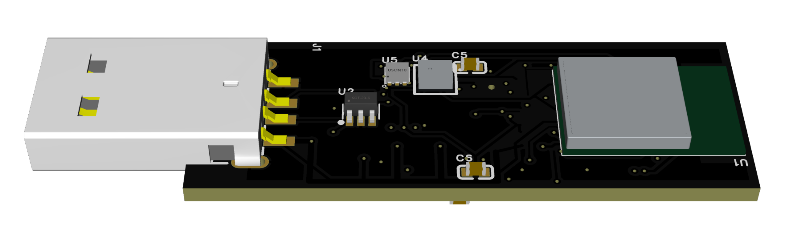
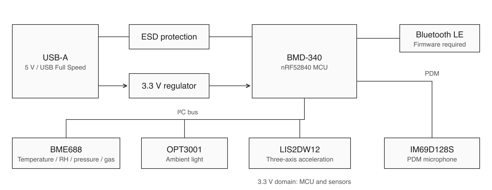
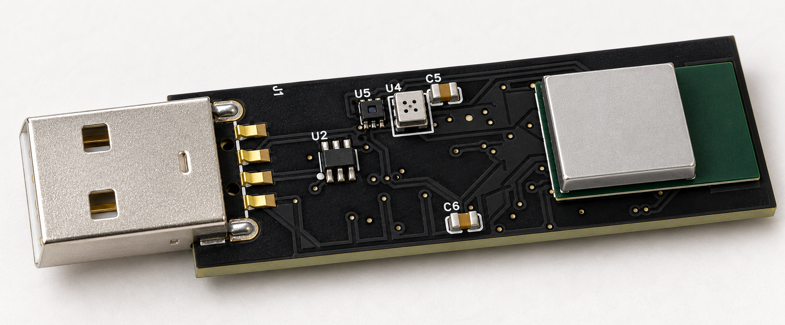

# ENVIO — USB Environmental Sensor

A compact USB-A environmental sensor prototype built around an **nRF52840 / BMD-340** module, with temperature, humidity, pressure, gas, light, motion, and microphone sensing.

**[View the project on OSHWLab](https://oshwlab.com/keisuke054/project_agusbwba)** — editable schematics and PCB, with BOM, CPL, and Gerber attachments.

**PCB: 46.48 × 17.5 mm · 4 copper layers · approximately 1.6 mm thick · components on both sides.** The dimensions describe the PCB outline, excluding the USB plug and enclosure.

*R1D assembly exported directly from EasyEDA with a black PCB and simplified BMD-340 and BME688 presentation models. Refer to the native design and component datasheets for dimensions.*

## Motivation

The motivation is to build a USB environmental sensor with publicly available, editable design files for monitoring tasks similar to those served by **OMRON's 2JCIE-BU01**. OMRON's [discontinuation notice](https://www.fa.omron.co.jp/data_pdf/closed/2024004c_on.pdf) lists the end of January 2025 as the final order period and the end of April 2025 as the final shipment period, with no recommended replacement.

The aim is a maintainable, modifiable sensor with editable hardware and future open-source firmware for USB/Bluetooth LE environmental monitoring. This is an independent design. Compatibility with OMRON's protocols and equivalent measurement performance have not been established.

## Project status

The project has been submitted to [OSHWLab](https://oshwlab.com/keisuke054/project_agusbwba); the submission screen reported pending platform review on 2026-10-17. This GitHub package is being prepared for release. The sensing and USB/BLE application firmware has **not been implemented**, and hardware operation has not been validated. This is a development prototype.

**Next steps:** I plan to order the prototype boards, verify the assembled hardware, and develop the application firmware and supporting software.

The project-owned hardware design and associated materials are licensed under **CC BY-NC-SA 4.0** for noncommercial reuse. **Commercial use requires a separate agreement; please contact [me](https://github.com/wonwondogs).** Because this license restricts commercial use, the project is not presented as open-source hardware under the OSHWA definition. Application firmware and its software license are still pending. See [licensing scope](LICENSING.md).

## Hardware

| Reference | Component | Purpose |
| --- | --- | --- |
| J1 | XUNPU USB-212-BCW | USB-A plug: 5 V input and USB Full Speed data |
| U1 | u-blox BMD-340-A-R / nRF52840 | MCU, USB, Bluetooth LE, and PDM interface |
| U2 | ST USBLC6-2SC6 | USB data-line ESD protection |
| U3 | AP2112K-3.3TRG1 | 5 V to 3.3 V regulator |
| U4 | Bosch BME688 | Temperature, relative humidity, pressure, and gas resistance |
| U5 | TI OPT3001 | Ambient light |
| U6 | ST LIS2DW12 | Three-axis acceleration |
| U7 | Infineon IM69D128S | Digital PDM microphone |

BME688 gas resistance is not a direct CO₂ measurement. Calibrated sound-pressure levels and processed air-quality estimates require additional algorithms and validation; they are not delivered by this repository.

## Functional overview

USB supplies 5 V; the regulator supplies the 3.3 V domain. The MCU connects to the three I²C sensors and to the PDM microphone. Bluetooth LE and USB data transport require application firmware.

## Files

| Location | Contents |
| --- | --- |
| [OSHWLab project](https://oshwlab.com/keisuke054/project_agusbwba) | Editable EasyEDA schematics and PCB, plus BOM, CPL, and Gerber attachments |
| [Schematic PDF](docs/usb-environment-sensor-r1d-schematic.pdf) | Three-page viewing export from EasyEDA |
| [Hardware reference](docs/hardware.md) | Power, interfaces, programming pads, and sensor limitations |
| [Manufacturing notes](docs/manufacturing.md) | Fabrication and assembly considerations |
| [Firmware development](firmware/README.md) | Planned firmware scope and initial programming requirements |
| [Images](images/README.md) | CAD preview, PCB artwork, functional diagram, and concept visualization |

Editable design and manufacturing files are hosted on OSHWLab. This repository contains the project documentation and viewing exports. Use the R1D Gerber ZIP and its matching BOM/CPL together.

## Programming

The underside has GND, 3V3, SWDIO, SWDCLK, and NRST test pads. Plan to use an external SWD probe for initial firmware programming. A USB connector alone does not establish that a USB bootloader is installed.

No firmware image, USB protocol, BLE service, or host application is provided yet. See [firmware development](firmware/README.md) and the [test-pad reference](docs/hardware.md#programming-pads).

## Reproducing and reviewing the hardware

1. Open the [OSHWLab project](https://oshwlab.com/keisuke054/project_agusbwba) and import its editable design into EasyEDA.
2. Review the schematics, PCB, and [manufacturing notes](docs/manufacturing.md).
3. Download the R1D Gerber ZIP, BOM, and CPL from the project attachments. Check assembler part assignments and orientation before ordering.

An enclosure, firmware, prototype bring-up, and physical RF/USB evaluation are still required. The electrical footprint retains its library's BMD-341 name; the selected BOM part and replacement presentation model are BMD-340, with an integrated antenna. Use the selected part's mechanical documentation for enclosure design.

## Product visualization

*Concept visualization based on the R1D CAD assembly. Component and surface details may differ from the design; use the native CAD preview above as the reference.*

## Licensing

The project-owned design files, documentation, and associated materials are licensed under **[Creative Commons Attribution-NonCommercial-ShareAlike 4.0 International (CC BY-NC-SA 4.0)](https://creativecommons.org/licenses/by-nc-sa/4.0/)**. Noncommercial sharing and adaptation are permitted subject to attribution and the license's ShareAlike terms.

**For commercial use, please contact [me](https://github.com/wonwondogs) to discuss a separate license and obtain permission before proceeding.** Contacting the author alone does not grant commercial permission. Read [LICENSE](LICENSE), [COPYRIGHT](COPYRIGHT), and [LICENSING.md](LICENSING.md) for the exact terms and file scope.

Third-party CAD-library material retains its original terms; see [THIRD_PARTY_NOTICES.md](THIRD_PARTY_NOTICES.md). The application firmware has not been implemented and will receive a suitable software license before release.
