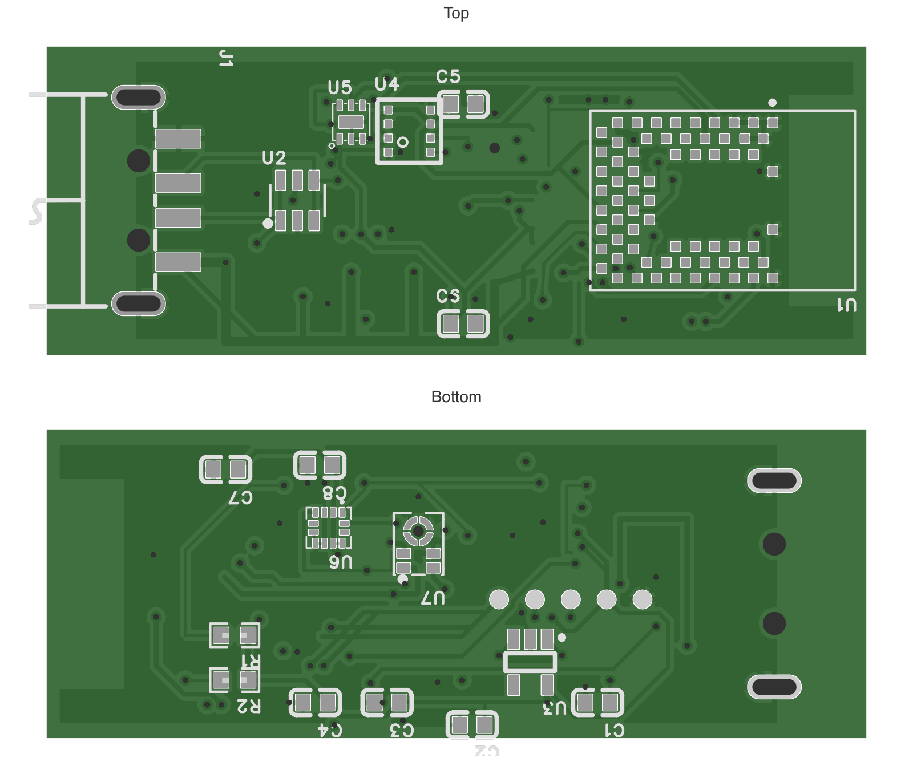

# Hardware reference

## PCB layouts

These previews are rendered from the R1D manufacturing files. The [native assembly preview](../images/usb-sensor-3d.svg) is exported from EasyEDA and shows the fitted components and USB plug, with black solder mask and simplified BMD-340 and BME688 presentation models. The BMD-340 model shows the unshielded integrated-antenna end without a coax connector. The README also includes a separate concept visualization. Use the [editable design and manufacturing files on OSHWLab](https://oshwlab.com/keisuke054/project_agusbwba) for electrical and layout decisions, and the selected components' mechanical documentation for body dimensions.

The [three-page schematic PDF](usb-environment-sensor-r1d-schematic.pdf) is a viewing export; edit the EasyEDA project to change the design.

## Board and power

- PCB outline: approximately 46.48 × 17.5 mm, excluding USB plug overhang.
- Stack: four copper layers, approximately 1.6 mm, with components on both sides.
- Supply: USB-A 5 V input, regulated to a 3.3 V domain by AP2112K.
- There is no battery, charging circuit, or display on this revision.

The outline measurements refer to the centerline of the board edge; a Gerber viewer may include the outline stroke in its reported bounding box. The USB connector extends outside the PCB and needs a separate mechanical check.

## Sensor connections

BME688, OPT3001, and LIS2DW12 share `I2C_SCL` and `I2C_SDA`. The microphone uses `PDM_CLK` and `PDM_DATA`. OPT3001 and LIS2DW12 have `LIGHT_INT` and `ACCEL_INT` signals respectively.

`LIGHT_INT` is open-drain: enable the nRF52840 GPIO internal pull-up in firmware, or review the need for an external pull-up in a later hardware revision.

The BMD-340 module has native USB data connections through the ESD device. Firmware must configure the USB and radio functions; neither interface has an implemented application protocol yet.

### Measurement scope

| Sensor | Intended raw measurements | Additional work |
| --- | --- | --- |
| BME688 | Temperature, humidity, pressure, gas resistance | Driver configuration, heater profile, compensation, calibration, and thermal assessment |
| OPT3001 | Ambient light | Driver implementation and optical-window validation |
| LIS2DW12 | Three-axis acceleration | Driver settings, interrupt handling, and orientation definition |
| IM69D128S | PDM audio samples | PDM capture, sample processing, and calibration for sound-pressure levels |

There is no direct CO₂ sensor. Derived air-quality or estimated-CO₂ outputs must identify the chosen algorithm and its validation separately.

## Programming pads

Pads are on the **bottom side**. Coordinates use the native design origin, not the top-left of a cropped preview. Verify orientation in the editable PCB before wiring.

| Pad | Signal | Center X (mm) | Center Y (mm) |
| --- | --- | --- | --- |
| TP1 | GND | 30.480 | 32.512 |
| TP2 | 3V3 | 32.512 | 32.512 |
| TP3 | SWDIO | 34.544 | 32.512 |
| TP4 | SWDCLK | 36.576 | 32.512 |
| TP5 | NRST | 38.608 | 32.512 |

Use a probe compatible with the 3.3 V target domain and confirm its power/voltage-reference configuration. The `3V3` pad is a target rail; it is not an instruction to power the board simultaneously from USB and a probe supply.

Check module/component pad assignments in the [editable EasyEDA project](https://oshwlab.com/keisuke054/project_agusbwba). Module-pad numbers are not MCU GPIO identifiers; translate them using the BMD-340 datasheet.

## Mechanical and RF considerations

The BMD-340 antenna requires the keepout in the source design. Enclosure metal, plastic, USB host placement, and the compact ground plane require physical RF evaluation. The original BMD-341 presentation body has been replaced with the simplified BMD-340 body; that visual change does not validate antenna clearance.

BME688 needs air exchange; OPT3001 needs an optical window; the bottom-port microphone needs its aligned **0.60 mm** board sound hole and suitable assembly handling. USB direct-insertion strength and enclosure dimensions are unverified.
